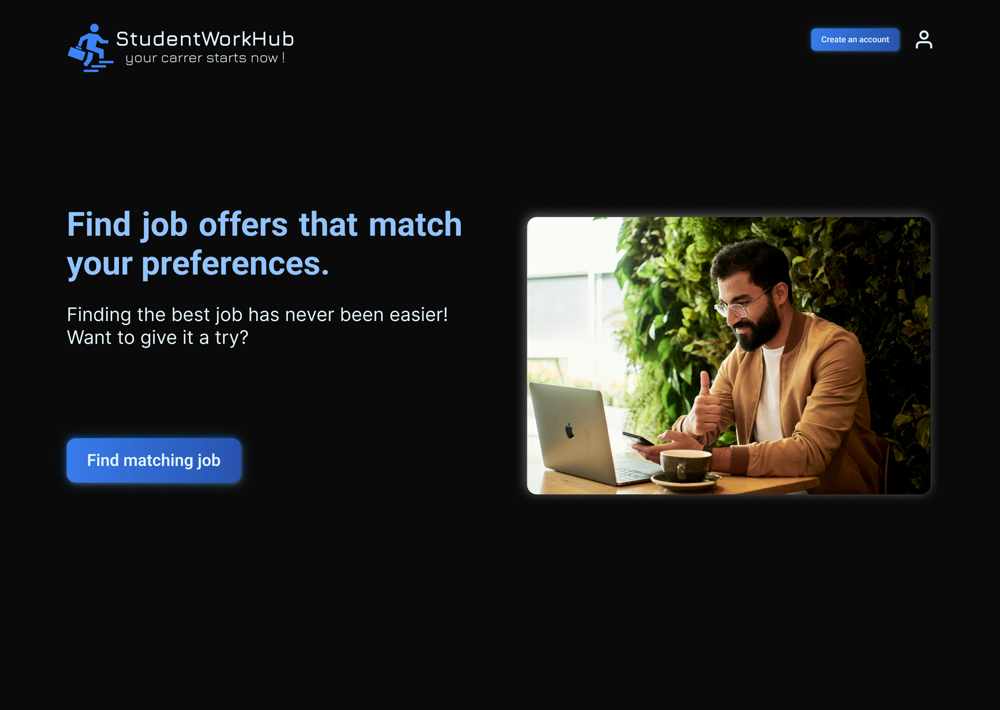
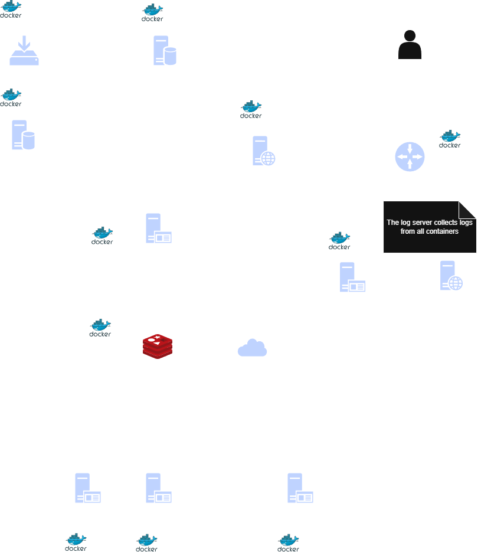
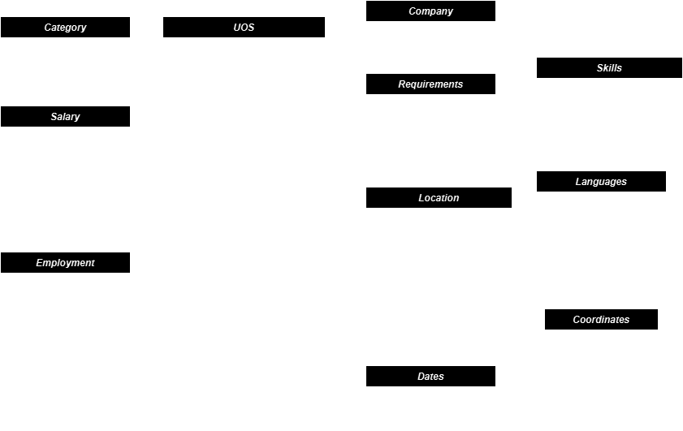

# StudentWorkHub 🚀

## 🤖 AI-powered job offer aggregation and analysis platform

StudentWorkHub is an intelligent platform designed to collect, normalize and analyze job offers from multiple employment platforms.

The system integrates with external job sources using API integrations and Web Scraping techniques, transforms heterogeneous job advertisements into a unified data structure, and applies AI-based analysis and ranking algorithms to provide users with relevant job opportunities.

The main goal of the project is to simplify job searching by converting unstructured job market data into structured, searchable and personalized information.

# 🎯 Project Overview

Modern job markets contain thousands of offers distributed across many different platforms.

Each provider uses its own:

- data structure
- naming conventions
- technology descriptions
- salary formats
- requirement definitions

This makes comparing job opportunities difficult and time-consuming.

StudentWorkHub solves this problem by introducing a unified processing pipeline:
```
External Job Sources
|
v
Data Collection Layer
|
v
Data Cleaning & Normalization
|
v
Unified Offer Schema (UOS)
|
v
AI Analysis Layer
|
v
Offer Ranking Engine
|
v
User Interface
```

The system converts raw job advertisements into structured information that can be analyzed, searched and ranked.


# 📡 Job Offer Sources

StudentWorkHub aggregates job offers from multiple employment platforms.

Data is collected using API integrations and Web Scraping mechanisms.

Current supported sources:

| Source | Integration method |
|---|---|
| Pracuj.pl | Web Scraping |
| OLX Praca | Web Scraping |
| Additional employment platforms | Extensible integration layer |

Each external source provides different data formats.

The collected data is transformed into the internal **Unified Offer Schema (UOS)**, allowing the rest of the system to operate independently from the original provider.

The architecture allows adding new job portals without modifying the core business logic.


## 🔎 Job Offer Aggregation

The system collects and processes job advertisements from different sources.

Features:

- external source integration
- data extraction
- duplicate detection
- validation
- normalization
- unified storage


## 🤖 AI-powered Offer Analysis

Job descriptions contain large amounts of unstructured information.

StudentWorkHub uses AI-based processing to extract important information:

- required technologies
- programming languages
- frameworks
- technical skills
- experience level
- job category
- additional requirements


## 🧠 Intelligent Offer Ranking

The system automatically ranks offers according to user preferences and offer characteristics.

Ranking factors include:

- technology compatibility
- required skills
- experience level
- salary expectations
- employment type
- location preferences
- remote/hybrid work mode


## Application Preview




#  System Architecture

The application follows a modular architecture separating different responsibilities.




# 🧩 Unified Offer Schema (UOS)

## Standardized representation of job offers

Different job portals provide different structures.

To solve this problem, StudentWorkHub introduces the **Unified Offer Schema (UOS)**.

UOS acts as a universal representation of job offers regardless of their original source.

Advantages:

- source-independent processing
- consistent data storage
- simplified ranking algorithms
- easier integration of new providers
- reduced duplication of source-specific logic





# 📋 Unified Offer Schema Structure

Every ingested offer — regardless of source — is transformed into the **Unified Offer Schema (UOS)** before storage. This enables consistent ranking and eliminates provider-specific quirks downstream.

<details>
<summary><strong>Field reference</strong></summary>

| Field | Type | Description |
|---|---|---|
| `id` | `number` | Unique offer identifier |
| `source` | `string` | Provider identifier, e.g. `"pracuj.pl"`, `"olx"` |
| `url` | `string` | Link to the original offer |
| `jobTitle` | `string` | Job title as listed in the offer |
| `company.name` | `string` | Company name |
| `company.logoUrl` | `string \| null` | Company logo URL *(optional)* |
| `description` | `string \| null` | Full offer description, used for AI tag extraction *(optional)* |
| `salary.from` | `number \| null` | Minimum salary *(optional)* |
| `salary.to` | `number \| null` | Maximum salary *(optional)* |
| `salary.currency` | `string \| null` | e.g. `"PLN"`, `"EUR"` |
| `salary.period` | `string \| null` | e.g. `"monthly"`, `"weekly"` |
| `salary.type` | `string \| null` | e.g. `"gross"`, `"net"` |
| `location.city` | `string \| null` | City |
| `location.street` | `string \| null` | Street name *(optional)* |
| `location.buildingNumber` | `string \| null` | Building number *(optional)* |
| `location.postalCode` | `string \| null` | Postal code *(optional)* |
| `location.coordinates.latitude` | `number \| null` | Latitude (null when longitude is null) |
| `location.coordinates.longitude` | `number \| null` | Longitude (null when latitude is null) |
| `location.isRemote` | `boolean \| null` | Fully remote (null when `isHybrid` is set) |
| `location.isHybrid` | `boolean \| null` | Hybrid mode (null when `isRemote` is set) |
| `category.leadingCategory` | `string` | Main category, e.g. `"Information-Technology"` |
| `category.subCategories` | `array \| null` | Sub-categories, e.g. `["Programming", "Designing"]` |
| `requirements.skills` | `array \| null` | List of required skills *(optional)* |
| `requirements.skills[].skill` | `string` | Skill name, e.g. `"Django"`, `"Driver's license"` |
| `requirements.skills[].experienceMonths` | `number \| null` | Required months of experience *(optional)* |
| `requirements.skills[].experienceLevel` | `array \| null` | e.g. `["Senior", "Intermediate"]` *(optional)* |
| `requirements.education` | `array \| null` | e.g. `["Bachelor's degree", "CCNA"]` *(optional)* |
| `requirements.languages` | `array \| null` | Required languages *(optional)* |
| `requirements.languages[].language` | `string` | Language name, e.g. `"English"` |
| `requirements.languages[].level` | `string` | Mastery level, e.g. `"C1"` |
| `employment.types` | `array` | Contract types, e.g. `["B2B", "Contract of mandate"]` |
| `employment.schedules` | `array` | Schedules, e.g. `["Full-time", "Part-time"]` |
| `dates.published` | `string` | Publication date (`YYYY-MM-DD HH:MI:SS`) |
| `dates.expires` | `string \| null` | Expiration date (`YYYY-MM-DD HH:MI:SS`) *(optional)* |
| `benefits` | `array \| null` | Employee benefits, e.g. `["private medical care"]` *(optional)* |
| `isUrgent` | `boolean` | Indicates urgent hiring |
| `isForUkrainians` | `boolean` | Indicates position primarily targeting Ukrainian applicants |

</details>

<br>

## Getting Started

```bash
# Clone the repository
git clone https://github.com/your-org/StudentWorkHub.git
cd StudentWorkHub

# Install dependencies
# (instructions per service TBD)

# Configure environment
cp .env.example .env
# Edit .env with your database credentials and API keys

# Run database migrations
# (instructions TBD)

# Start the application
# (instructions TBD)
```

<br>

## Contributing

Contributions are welcome. Please open an issue first to discuss what you would like to change, then submit a pull request against the `develop` branch.

1. Fork the repository
2. Create a feature branch (`git checkout -b feature/your-feature`)
3. Commit your changes (`git commit -m 'feat: add your feature'`)
4. Push to the branch (`git push origin feature/your-feature`)
5. Open a Pull Request

Please follow [Conventional Commits](https://www.conventionalcommits.org/) for commit messages.

## License

This project is licensed under the **MIT License** — see the [LICENSE](LICENSE) file for details.


<p align="center">Made with ☕ for students, by students.</p>